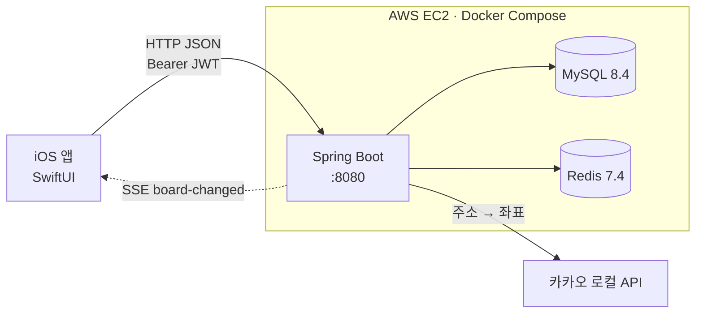

# Slotty Server

[](https://github.com/team-slotty/slotty-server/actions/workflows/ci.yml)

빌라(다세대 주택) 주차 관리 앱 **Slotty**의 백엔드입니다.
빌라 주차장은 배정 면과 공용 면이 섞여 있고 관리인이 없어 "지금 어느 면이 비었는지, 누구 차가 서 있는지"를 알기 어렵습니다.
Slotty는 입주민이 입차·출차를 기록하고, 빌라 주차 현황판으로 빈 면·주차 중인 차·방문 예정·미확인 차량을 한눈에 보게 합니다.

- iOS 앱: [team-slotty/slotty-ios](https://github.com/team-slotty/slotty-ios)
- API 문서(Swagger): http://16.184.54.156:8080/swagger-ui/index.html

## 팀

| 이름 | 역할 |
| --- | --- |
| 우희정 | 기획, iOS (SwiftUI) |
| 길선아 | 백엔드 전체 (API 설계·구현, DB, 인증, 배포) |

## 주요 기능

기획서의 API 50개를 모두 구현했습니다 (Swagger 기준 53개, 헬스 체크·기존 현황판 포함).

- **회원가입·로그인**: JWT Access Token + Redis에 저장하는 Refresh Token(회전 방식), 로그아웃
- **내 정보**: 이름·전화번호·연락처 공개 수정, 탈퇴(소프트 삭제·익명화, 모든 기기 Refresh 폐기, 관리자는 위임 후 탈퇴)
- **빌라 온보딩**: 빌라·세대·주차면·배정을 한 번에 생성, 배치 템플릿(일자·이중·L자) × 입구 방향으로 면 좌표 자동 계산, 카카오 로컬 API로 주소 → 기준점 좌표 변환(실패해도 생성은 성공)
- **관리자**: 빌라 이름·주소 수정, 기준점 재설정·현장 보정, 배치 변경, 세대 추가·삭제, 초대 코드 재발급, 세대원 내보내기, 면 배정, 관리자 위임
- **세대 참여**: 초대 코드로 세대에 소속 (틀린 코드 5회 시 10분 제한)
- **차량 관리**: 차량 등록·조회·수정·삭제, 같은 빌라 안 번호판 중복 방지
- **입차·출차**: 운행 중인 차 대수에 따라 차량·면 자동 추천, 재전송 중복 방지, 동승자 중복 무시, 출차 누락 자동 정리, 입출차 이력(30일)
- **주차 현황판**: 배치도 좌표 + 면별 7가지 상태(미확인·사용 중·확인 필요·방문 중·방문 예정·가용시간·빈 면) + 내 차 + 오늘 방문, 실시간 변경 알림(SSE)
- **면 상세**: 상태·주차 차량·방문·미확인 기록과 버튼 권한(기록·해제·내 차예요)
- **차량번호 검색**: 뒤 4자리 이상으로 입주민 차량·방문차량 검색, 연락처 공개 동의 시 전화, 하루 20회 제한(Redis)
- **가용시간**: 면 주인이 빈 시간을 공유(매주 반복·하루, 종일·시간), [이번만 해제], 주인 입차 시 자동 해제
- **방문차량**: 방문 등록(공용 면 또는 가용시간이 방문 시간 전체를 덮는 면 지정), 지정 가능 면 조회, 목록·상세·수정·삭제·[방문 종료], 자주 오는 차(최근 5대), 가용시간이 사라지면 면 지정 취소 표시
- **미확인 차량**: 관리자·면 주인이 기록, [차량 떠남] 해제, [내 차예요] 정정(정정 입차 기록 생성), 정상 입차 시 자동 해제, 관리자 이력
- **기록 정리**: 매일 새벽 출차 후 30일 지난 입출차 기록, 해제 후 7일 지난 미확인 기록 자동 삭제

## 기술 스택

| 분류 | 기술 | 선택 이유 |
| --- | --- | --- |
| 언어·프레임워크 | Java 21, Spring Boot 4.1 | 팀 과정 표준, record·switch 식 등 최신 문법 |
| 데이터 | Spring Data JPA (Hibernate 7), MySQL 8.4 | 관계가 많은 도메인(빌라-세대-면-차량-기록-방문)을 엔티티로 표현, fetch join으로 쿼리 수 제어 |
| 스키마 관리 | Flyway | 테이블은 SQL 마이그레이션으로만 만들고 JPA는 `ddl-auto: validate`로 검증만 → 스키마 변경 이력이 코드로 남음 |
| 인증 | Spring Security, JWT(jjwt), Redis | Access Token은 서버에 저장하지 않는 JWT, Refresh Token은 Redis에 TTL과 함께 저장해 로그아웃·회전 시 즉시 무효화 |
| 캐시·카운터 | Redis 7.4 | Refresh Token, 초대 코드 시도 횟수 제한, 차량번호 검색 하루 20회 (TTL 내장) |
| 외부 API | 카카오 로컬 API (Spring `RestClient`) | 빌라 주소 → 기준점 좌표. 3초 타임아웃, 실패해도 예외 대신 `geocodeFailed: true` |
| 실시간 | Server-Sent Events (`SseEmitter`) | 앱 → 서버 단방향 구독이면 충분하고 WebSocket보다 단순. 일반 HTTP라 추가 인프라 없음 |
| 스케줄러 | Spring `@Scheduled` | 보관 기간이 지난 기록 정리, SSE heartbeat |
| 문서 | springdoc-openapi (Swagger UI) | 코드에서 API 문서 자동 생성, Authorize 버튼으로 바로 테스트 |
| 테스트·CI | JUnit 5, Mockito, GitHub Actions | PR마다 MySQL·Redis 서비스 컨테이너로 빌드·테스트 |
| 배포 | Docker, Docker Compose, AWS EC2 | 앱·MySQL·Redis를 한 번에 띄우고 로컬과 같은 환경으로 실행 |

## 아키텍처



- 요청 흐름: `JwtAuthenticationFilter`(토큰 검증) → Controller → Service(트랜잭션·업무 규칙) → Repository(JPA) → MySQL
- 현황판 알림: Service가 `BoardChangedEvent` 발행 → **커밋 후** `BoardSseHub`가 같은 빌라의 연결에 `board-changed` 전송 → 앱이 현황판 다시 조회
- 에러 응답은 항상 `{ "code", "message", "details" }` 형식 (`GlobalExceptionHandler`)

## 패키지 구조

```
com.slotty.server
├── domain                  # 기능별 패키지 (엔티티·Repository + controller/service/dto)
│   ├── auth                # 회원가입·로그인·토큰 재발급·로그아웃
│   ├── user                # 사용자, 내 정보 조회·수정·탈퇴
│   ├── villa               # 빌라·세대 엔티티, 빌라 온보딩·설정, 관리자 확인
│   ├── household           # 초대 코드 참여, 내 세대, 관리자 세대 관리
│   ├── slot                # 주차면, 배치 좌표 계산, 면 상세, 면 배정
│   ├── vehicle             # 차량 관리, 차량번호 검색
│   ├── parking             # 입차·출차·이력
│   ├── board               # 주차 현황판, 상태 판정, SSE(event·sse), 내 차 상태
│   ├── availability        # 가용시간, [이번만 해제]
│   ├── visit               # 방문차량, 면 지정 규칙, 자주 오는 차
│   └── unidentified        # 미확인 차량 기록·해제·정정·이력
└── global
    ├── auth                # JWT 발급·검증 필터, 401 응답
    ├── config              # Security, JPA Auditing, Swagger, OSIV, Scheduling
    ├── entity              # BaseTimeEntity (created_at)
    ├── exception           # ErrorCode, BusinessException, GlobalExceptionHandler
    ├── external            # 카카오 로컬 API 클라이언트
    ├── health              # 헬스 체크
    ├── scheduler           # 기록 정리 스케줄러
    └── util                # 시각 변환
```

## ERD


- 테이블 11개: `villa`, `household`, `users`, `parking_slot`, `vehicle`, `parking_record`, `visit`, `frequent_vehicle`, `availability`, `availability_exception`, `unidentified_report`
- 스키마: [`V1__init.sql`](src/main/resources/db/migration/V1__init.sql)
- **상태는 저장하지 않고 계산**: `exited_at`이 NULL이면 주차 중, `resolved_at`이 NULL이면 미해제, 방문 상태는 `start_at`·`end_at`·`ended_at`과 현재 시각으로 계산
- **DB가 규칙을 보장**: 생성 컬럼 `open_slot_id`/`open_vehicle_id` + UNIQUE로 "면당·차량당 열린 기록 1개", 미확인도 같은 방식으로 "면당 열린 기록 1개", `(villa_id, plate_number)` UNIQUE로 빌라 안 번호판 중복 방지, CHECK로 `exited_at >= entered_at`·방문 24시간 이하

## API

모든 API는 `Authorization: Bearer {accessToken}`이 필요합니다 (회원가입·로그인·토큰 재발급·헬스 체크 제외).
자세한 요청·응답은 [Swagger](http://16.184.54.156:8080/swagger-ui/index.html)에서 확인할 수 있습니다.

| 분류 | Method | Path | 설명 |
| --- | --- | --- | --- |
| 인증 | POST | `/api/auth/signup` | 회원가입 (201, 토큰 발급) |
| | POST | `/api/auth/login` | 로그인 |
| | POST | `/api/auth/reissue` | 토큰 재발급 (Refresh 회전) |
| | POST | `/api/auth/logout` | 로그아웃 (204) |
| 내 정보 | GET | `/api/me` | 내 정보·세대·빌라·관리자 여부 |
| | PATCH | `/api/me` | 이름·전화번호·연락처 공개 수정 |
| | DELETE | `/api/me` | 탈퇴 (204) |
| 빌라 | POST | `/api/villas` | 빌라 온보딩 (빌라·세대·면·배정 한 번에, 201) |
| | GET | `/api/villas/me` | 빌라 정보 |
| | PATCH | `/api/villas/me` | 빌라 이름·주소 수정 (관리자) |
| | PUT | `/api/villas/me/anchor` | 기준점 재설정·현장 보정 (관리자) |
| | PUT | `/api/villas/me/layout` | 배치 템플릿·입구·면 수 변경 (관리자) |
| | PUT | `/api/villas/me/admin` | 관리자 위임 (관리자, 204) |
| 세대 | GET | `/api/households` | 세대 목록·초대 코드·세대원 (관리자) |
| | POST | `/api/households` | 세대 추가 (관리자, 201) |
| | DELETE | `/api/households/{householdId}` | 세대 삭제 (관리자, 204) |
| | POST | `/api/households/{householdId}/invite-code/reissue` | 초대 코드 재발급 (관리자) |
| | DELETE | `/api/households/{householdId}/members/{memberId}` | 세대원 내보내기 (관리자, 204) |
| | POST | `/api/households/join` | 초대 코드로 세대 참여 |
| | GET | `/api/households/me` | 내 세대·배정 면·세대원 |
| 주차면 | PUT | `/api/parking-slots/assignments` | 세대별 면 배정 (관리자, 204) |
| | GET | `/api/parking-slots/{slotId}` | 면 상세 + 버튼 권한 |
| 현황판 | GET | `/api/parking-board` | 주차 현황판 (배치·7가지 상태·방문·내 차·오늘 방문) |
| | GET | `/api/parking-board/stream` | 현황판 변경 알림 (SSE) |
| | GET | `/api/board` | 초기 현황판 (iOS 이전 후 삭제 예정) |
| 차량 | GET | `/api/vehicles` | 내 세대 차량 목록 |
| | POST | `/api/vehicles` | 차량 등록 (201) |
| | PATCH | `/api/vehicles/{vehicleId}` | 차량 수정 |
| | DELETE | `/api/vehicles/{vehicleId}` | 차량 삭제 (204) |
| | GET | `/api/vehicles/me` | 내 차 상태 (주차 중·운행 중) |
| | GET | `/api/vehicles/search?plate=` | 차량번호 검색 (입주민·방문차량, 하루 20회) |
| 입출차 | GET | `/api/parking/check-in-options` | 입차 차량·면 자동 추천 |
| | POST | `/api/parking/check-in` | 입차 (201, 재전송·동승자면 200) |
| | GET | `/api/parking/check-out-options` | 출차 차량 자동 추천 |
| | POST | `/api/parking/check-out` | 출차 |
| | GET | `/api/parking/history` | 내 세대 입출차 이력 (30일, 페이지) |
| 방문 | POST | `/api/visits` | 방문차량 등록 (201) |
| | GET | `/api/visits/available-slots?startAt=&endAt=` | 방문 지정 가능한 면 |
| | GET | `/api/visits?scope=UPCOMING\|ONGOING\|PAST` | 우리 세대 방문 목록 (페이지) |
| | GET | `/api/visits/{visitId}` | 방문 상세 + 등록자 연락처 |
| | PATCH | `/api/visits/{visitId}` | 방문 수정 (시작 전) |
| | DELETE | `/api/visits/{visitId}` | 방문 삭제 (시작 전, 204) |
| | POST | `/api/visits/{visitId}/end` | [방문 종료] |
| | GET | `/api/frequent-vehicles` | 자주 오는 방문차 (최근 5대) |
| 미확인 차량 | POST | `/api/unidentified-reports` | 미확인 차량 기록 (관리자·면 주인, 201) |
| | POST | `/api/unidentified-reports/{reportId}/resolve` | [차량 떠남] 해제 |
| | POST | `/api/unidentified-reports/{reportId}/mine` | [내 차예요] 정정 (면 주인) |
| | GET | `/api/unidentified-reports?status=ALL\|OPEN\|RESOLVED` | 미확인 기록 이력 (관리자, 페이지) |
| 가용시간 | GET | `/api/availabilities` | 우리 면 가용시간 목록 (면 주인) |
| | POST | `/api/availabilities` | 가용시간 등록 (201) |
| | DELETE | `/api/availabilities/{availabilityId}` | 가용시간 삭제 (204) |
| | POST | `/api/availabilities/{availabilityId}/exceptions` | [이번만 해제] (201) |
| 기타 | GET | `/api/health` | 서버 상태 확인 |

### Swagger에서 테스트하기

1. `POST /api/auth/login` → Try it out → `{ "loginId": "kim101", "password": "slotty1234!" }` → Execute
2. 응답의 `accessToken` 값만 복사
3. 우측 상단 **Authorize** → 붙여 넣기 → Authorize → Close
4. 이후 모든 요청에 토큰이 자동으로 붙습니다 (30분 후 만료 시 다시 로그인)

## 로컬 실행

### 준비물

- Java 21, Docker (Compose 포함)

### 1. MySQL·Redis 실행

```bash
docker compose up -d
```

MySQL은 `localhost:3307`(계정 `slotty` / `localdev`, 로컬 전용), Redis는 `localhost:6379`로 뜹니다.

### 2. 비밀값 준비

비밀값은 레포에 없습니다. 각자 만들어 환경 변수로 넣습니다.

| 환경 변수 | 필수 | 설명 |
| --- | --- | --- |
| `JWT_SECRET` | O | `openssl rand -base64 48`로 생성 |
| `KAKAO_REST_API_KEY` | X | 카카오 개발자 콘솔의 REST API 키 (카카오맵 사용 설정 필요). 없으면 주소 변환을 건너뛰고 `geocodeFailed: true` |

### 3. 서버 실행 (local 프로필)

```bash
JWT_SECRET=<위에서 만든 값> ./gradlew bootRun --args='--spring.profiles.active=local'
```

IntelliJ에서는 Run Configuration에 `Active profiles: local`, 환경 변수 `JWT_SECRET=...;KAKAO_REST_API_KEY=...`을 넣고 실행합니다.

- 서버 시작 시 Flyway가 테이블을 만들고, local 프로필에서는 테스트 데이터(`db/seed/R__local_seed.sql`)를 넣습니다
- 확인: http://localhost:8080/api/health , http://localhost:8080/swagger-ui/index.html

### 4. 테스트

```bash
./gradlew clean test
```

입차·출차 규칙(Mockito), 가용시간 회차 판정, 애플리케이션 컨텍스트 로딩 테스트가 있습니다. CI에서도 같은 명령을 MySQL·Redis 서비스 컨테이너와 함께 실행합니다.

### 테스트 계정 (seed, 비밀번호 모두 `slotty1234!`)

| 아이디 | 세대 | 비고 |
| --- | --- | --- |
| `kim101` | 101호 | 빌라 관리자, 차량 2대 (1대 1번 면 주차 중) |
| `lee201` | 201호 | 차량 1대 (운행 중) |
| `park202` | 202호 | 차량 1대 (4번 면 주차 중) |
| `choi302` | 302호 | 배정 면 없음, 차량 1대 (공용 7번 면 주차 중) |

초대 코드(새 계정으로 참여 테스트): `SEED101AAAA`(101호), `SEED201CCCC`(201호), `SEED302FFFF`(302호)

## 배포 (AWS EC2)

- EC2(Ubuntu, t3.small, 서울)에서 `compose.prod.yaml`로 앱·MySQL·Redis를 함께 실행
- 비밀값(`DB_PASSWORD`, `MYSQL_ROOT_PASSWORD`, `JWT_SECRET`, `KAKAO_REST_API_KEY`)은 EC2의 `.env`에만 두고 레포에는 올리지 않음
- `main` 브랜치가 배포 대상. 재배포:

```bash
cd ~/slotty-server && git pull && docker compose -f compose.prod.yaml up -d --build
```

## 브랜치·협업 규칙

- 기능 하나 = 이슈 → `feat/기능` 브랜치 → PR → `dev` 머지 → 배포할 때 `dev → main` PR
- 커밋·이슈·PR 제목에 타입 접두어: `feat:`, `fix:`, `docs:`, `chore:`, `refactor:`, `test:`, `ci:`
- PR마다 GitHub Actions CI(빌드·테스트) 통과 후 머지

## 기술적 고민과 트러블슈팅

### 1. 현황판 N+1 문제 → 빌라 단위 조회로 쿼리 수 고정

- **문제**: 열린 입차 기록을 가져온 뒤 기록마다 차량·세대를 지연 로딩 → 기록 수만큼 쿼리가 늘어남 (seed 데이터 기준 요청 한 번에 10번)
- **확인**: Hibernate 통계(`generate_statistics`)로 요청당 쿼리 수 측정
- **해결 1 (초기 현황판)**: `join fetch r.vehicle v join fetch v.household`로 필요한 연관만 한 번에 조회. 면 목록은 `left join fetch s.household`(공용 면은 세대가 없어 left) → 3번 고정
- **해결 2 (완성 현황판)**: 면·입차 기록·미확인·방문·가용시간·해제 예외를 **빌라 단위로 한 번씩** 조회해 면 id → 값 `Map`으로 묶고, 면마다 Map에서 꺼냄 → 면 7개든 12개든 **9번 고정**

### 2. 동시 입차 → Redis 락 대신 DB 유니크 제약

- 두 사람이 같은 면에 동시에 입차하면 둘 다 "빈 면" 확인을 통과할 수 있음
- 생성 컬럼 `open_slot_id`(열린 기록일 때만 slot_id) + UNIQUE로 **DB가 최종 보장**
- 서비스는 먼저 확인해 친절한 409를 주고, 동시 요청으로 제약 위반(`DataIntegrityViolationException`)이 나면 `saveAndFlush`로 그 자리에서 잡아 같은 409로 변환. "앞의 확인은 친절함, 뒤의 제약은 안전장치"
- 미확인 기록도 같은 방식 (동시 5건 → 1건 성공)

### 3. 동시 방문 면 지정 → 비관적 락 + READ COMMITTED

- 방문은 시간 구간의 겹침이라 유니크 제약으로 표현할 수 없음 → 면 행에 `SELECT ... FOR UPDATE`(`@Lock(PESSIMISTIC_WRITE)`)로 같은 면 요청을 한 줄로 세움
- **문제**: 락을 걸었는데도 동시 2건이 모두 성공. MySQL 기본 격리 수준(REPEATABLE READ)은 트랜잭션 첫 조회 시점의 스냅샷을 계속 읽어서, 락을 기다렸다 받아도 앞 요청이 방금 커밋한 방문이 보이지 않음
- **해결**: 등록·수정만 `@Transactional(isolation = READ_COMMITTED)` → 쿼리마다 최신 커밋을 읽음. 동시 5건 × 3라운드 매번 1건만 성공
- 미확인 해제는 락을 건 그 행을 다시 읽는 구조라(락 조회는 항상 최신 행) 격리 수준 변경 없이 해결

### 4. 출차 누락 정리 + 새 입차에서 유니크 위반 → flush 순서

- 출차를 안 누르고 나간 차가 다시 입차하면 옛 기록을 자동으로 닫고(UPDATE) 새 기록을 만듦(INSERT)
- Hibernate는 flush할 때 **INSERT를 UPDATE보다 먼저** 실행 → 옛 기록이 열린 채로 새 열린 기록이 들어가 `open_vehicle_id` 위반
- 옛 기록을 닫은 직후 `flush()`로 UPDATE를 먼저 보냄. 이후 단계에서 실패하면 트랜잭션 롤백으로 UPDATE도 함께 취소됨 (flush는 전송, commit이 확정)

### 5. 재전송·동승자 중복 입차

- 앱이 만든 UUID(`clientRequestId`)를 UNIQUE로 저장 → 네트워크 재시도로 같은 요청이 와도 처음 결과를 그대로 반환 (멱등성). [내 차예요] 정정도 같은 방식
- 다른 세대원이 5분 안에 같은 차를 이미 입차시켰으면 무시하고 기존 기록 반환 (동승자 규칙)

### 6. Refresh Token 회전과 탈취 대응

- Refresh Token은 UUID로 만들어 Redis에 `refresh:{token} → userId`, TTL 14일로 저장
- 재발급 시 `getAndDelete`로 **읽기와 삭제를 한 번에** → 같은 Refresh Token은 한 번만 사용 가능. 로그아웃은 Redis 키 삭제 (이미 없어도 204, 멱등)
- 탈퇴 시 `SCAN`(KEYS는 Redis를 멈춤)으로 그 사용자의 Refresh를 모든 기기에서 폐기

### 7. SSE 연결이 DB 커넥션 풀을 고갈

- **문제**: SSE 연결 15개에서 다른 API가 30초 대기 후 500 (`Connection is not available, total=10, active=10`)
- **원인**: 기본값 OSIV(`open-in-view`)는 요청이 끝날 때까지 DB 커넥션을 붙잡음. SSE 요청은 30분 동안 끝나지 않음
- **해결**: 기본 OSIV를 끄고 `OpenEntityManagerInViewInterceptor`를 직접 등록하면서 SSE 경로만 제외 → 다른 API의 동작은 그대로. SSE 21개 연결 중에도 일반 API 20~60ms

### 8. SSE 종료 시 Access Denied

- **원인**: SseEmitter가 끝나면 서블릿이 같은 요청을 ASYNC로 재디스패치하는데, JWT 필터(`OncePerRequestFilter`)는 재디스패치에서 다시 돌지 않아 인증 정보가 비어 인가 실패
- **해결**: `dispatcherTypeMatchers(DispatcherType.ASYNC).permitAll()` (첫 요청에서 이미 인증·인가 통과)

### 9. 벌크 삭제와 영속성 컨텍스트

- 차량 삭제 전 주차 중이던 면 번호를 얻으려고 입차 기록 **엔티티**를 조회 → 기록은 벌크 JPQL로 DB에서만 지우고 차량을 삭제하자, flush 때 "관리 중인 기록이 삭제된 차량을 참조" 오류
- 면 id만 스칼라 조회(`select r.slot.id ...`)로 바꿔 영속성 컨텍스트에 엔티티를 올리지 않음

### 10. 없는 경로·서버 오류가 전부 401로 보이던 문제

- **원인**: 처리되지 않은 예외는 서블릿이 `/error`로 다시 요청하는데, Security가 `/error`까지 인증을 요구해 404·405·500이 모두 401로 가려짐
- **해결**: `/error`를 permitAll, `NoResourceFoundException` 핸들러로 없는 경로는 우리 형식의 404 `NOT_FOUND`

### 11. 시각 형식과 초 단위 절삭

- 요청은 오프셋 포함(`2026-11-22T18:20:00+09:00`)으로 받아 KST로 변환, 응답은 오프셋 없는 KST
- 처음 응답은 마이크로초까지, 재전송 응답은 DB(DATETIME, 초 단위)에서 읽어 값이 달라지는 문제 → 저장 전에 초 단위로 절삭

## 앞으로 할 일

- iOS가 새 현황판으로 옮긴 뒤 초기 `/api/board` 삭제
- 서비스 단위 테스트 확대 (방문 면 지정 규칙, 미확인 정정, 탈퇴)
- 서버를 여러 대로 늘릴 때: SSE 이벤트를 Redis Pub/Sub으로 서버 간 전달, Refresh Token을 사용자별 Set으로 관리
