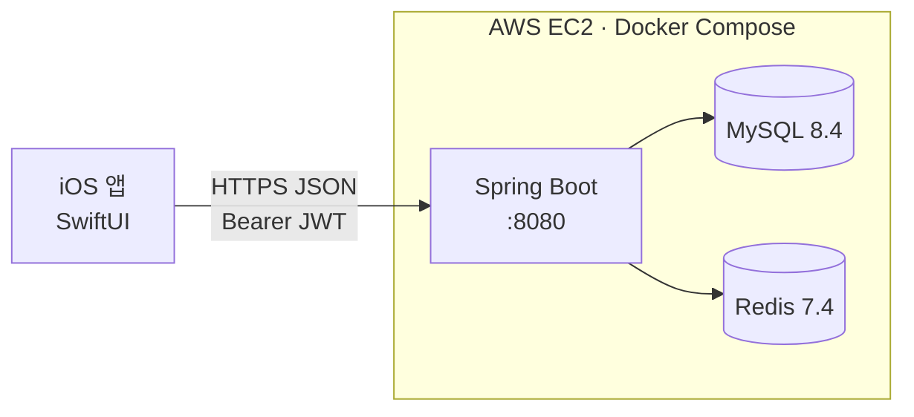
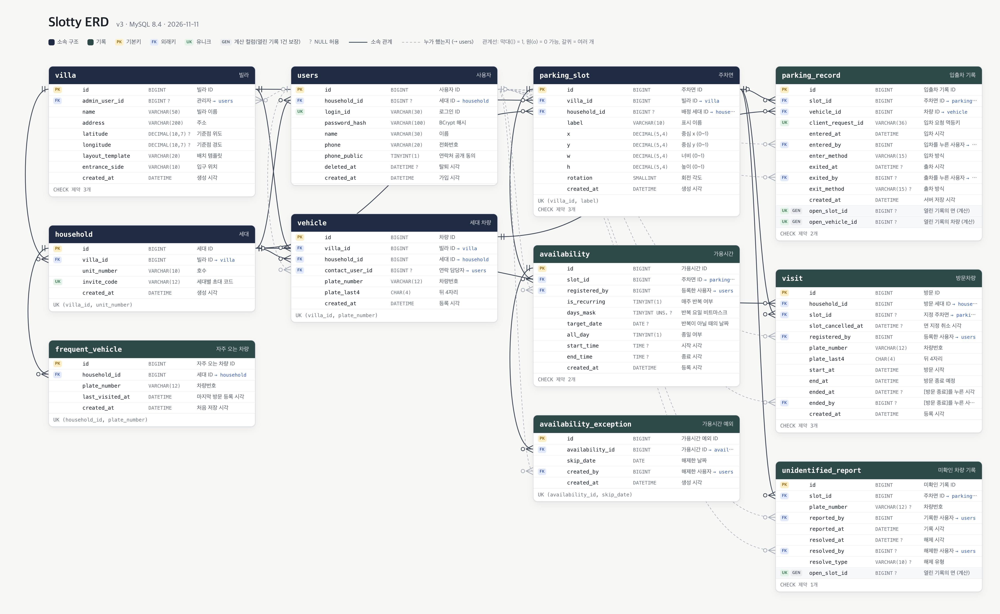

# Slotty Server

빌라(다세대 주택) 주차 관리 앱 **Slotty**의 백엔드입니다.
빌라 주차장은 배정 면과 공용 면이 섞여 있고 관리인이 없어 "지금 어느 면이 비었는지, 누구 차가 서 있는지"를 알기 어렵습니다.
Slotty는 입주민이 입차·출차를 기록하고, 빌라 주차 현황판으로 빈 면과 주차 중인 차를 한눈에 보게 합니다.

- iOS 앱: [team-slotty/slotty-ios](https://github.com/team-slotty/slotty-ios)
- API 문서(Swagger): http://16.184.54.156:8080/swagger-ui/index.html

## 팀

| 이름 | 역할 |
| --- | --- |
| 우희정 | 기획, iOS (SwiftUI) |
| 길선아 | 백엔드 전체 (API 설계·구현, DB, 인증, 배포) |

## 주요 기능 (구현된 API 기준)

- **회원가입·로그인**: JWT Access Token + Redis에 저장하는 Refresh Token(회전 방식), 로그아웃
- **세대 참여**: 초대 코드로 세대에 소속 (틀린 코드 5회 시 10분 제한)
- **차량 관리**: 차량 등록·조회·수정·삭제, 같은 빌라 안 번호판 중복 방지
- **입차·출차**: 운행 중인 차 대수에 따라 차량·면 자동 추천, 재전송 중복 방지, 동승자 중복 무시, 출차 누락 자동 정리
- **주차 현황판**: 빌라 배치도 좌표 + 면별 상태(사용 중·빈 면) + 내 차량 상태

## 기술 스택

| 분류 | 기술 | 선택 이유 |
| --- | --- | --- |
| 언어·프레임워크 | Java 21, Spring Boot 4.1 | 팀 과정 표준, record·switch 식 등 최신 문법 |
| 데이터 | Spring Data JPA (Hibernate 7), MySQL 8.4 | 관계가 많은 도메인(빌라-세대-면-차량-기록)을 엔티티로 표현, fetch join으로 쿼리 수 제어 |
| 스키마 관리 | Flyway | 테이블은 SQL 마이그레이션으로만 만들고 JPA는 `ddl-auto: validate`로 검증만 → 스키마 변경 이력이 코드로 남음 |
| 인증 | Spring Security, JWT(jjwt), Redis | Access Token은 서버에 저장하지 않는 JWT, Refresh Token은 Redis에 TTL과 함께 저장해 로그아웃·회전 시 즉시 무효화 |
| 캐시·카운터 | Redis 7.4 | Refresh Token, 초대 코드 시도 횟수 제한 (TTL 내장) |
| 문서 | springdoc-openapi (Swagger UI) | 코드에서 API 문서 자동 생성, Authorize 버튼으로 바로 테스트 |
| 배포 | Docker, Docker Compose, AWS EC2 | 앱·MySQL·Redis를 한 번에 띄우고 로컬과 같은 환경으로 실행 |

## 아키텍처



- 요청 흐름: `JwtAuthenticationFilter`(토큰 검증) → Controller → Service(트랜잭션·업무 규칙) → Repository(JPA) → MySQL
- 에러 응답은 항상 `{ "code", "message", "details" }` 형식 (`GlobalExceptionHandler`)

## 패키지 구조

```
com.slotty.server
├── domain                  # 기능별 패키지 (엔티티·Repository + controller/service/dto)
│   ├── auth                # 회원가입·로그인·토큰 재발급·로그아웃
│   ├── user                # 사용자, 내 정보
│   ├── villa               # 빌라·세대 엔티티
│   ├── household           # 초대 코드 참여, 내 세대
│   ├── vehicle             # 차량 관리
│   ├── slot                # 주차면
│   ├── parking             # 입차·출차
│   ├── board               # 주차 현황판, 내 차 상태
│   ├── availability        # 가용시간 (입차 시 자동 해제에 사용)
│   ├── unidentified        # 미확인 차량 (입차 시 자동 해제에 사용)
│   └── visit               # 방문차량 (설계만)
└── global
    ├── auth                # JWT 발급·검증 필터, 401 응답
    ├── config              # Security, JPA Auditing, Swagger
    ├── entity              # BaseTimeEntity (created_at)
    ├── exception           # ErrorCode, BusinessException, GlobalExceptionHandler
    └── util                # 시각 변환
```

## ERD



- 테이블 10개: `villa`, `household`, `users`, `parking_slot`, `vehicle`, `parking_record`, `visit`, `availability`, `availability_exception`, `unidentified_report`
- 스키마: [`V1__init.sql`](src/main/resources/db/migration/V1__init.sql)
- **상태는 저장하지 않고 계산**: `exited_at`이 NULL이면 주차 중, `resolved_at`이 NULL이면 미해제
- **DB가 규칙을 보장**: 생성 컬럼 `open_slot_id`/`open_vehicle_id` + UNIQUE로 "면당·차량당 열린 기록 1개", `(villa_id, plate_number)` UNIQUE로 빌라 안 번호판 중복 방지, CHECK로 `exited_at >= entered_at`

## API

모든 API는 `Authorization: Bearer {accessToken}`이 필요합니다 (회원가입·로그인·토큰 재발급 제외).
자세한 요청·응답은 [Swagger](http://16.184.54.156:8080/swagger-ui/index.html)에서 확인할 수 있습니다.

| 분류 | Method | Path | 설명 |
| --- | --- | --- | --- |
| 인증 | POST | `/api/auth/signup` | 회원가입 (201, 토큰 발급) |
| | POST | `/api/auth/login` | 로그인 |
| | POST | `/api/auth/reissue` | 토큰 재발급 (Refresh 회전) |
| | POST | `/api/auth/logout` | 로그아웃 (204) |
| 사용자 | GET | `/api/me` | 내 정보·세대·빌라·관리자 여부 |
| 세대 | POST | `/api/households/join` | 초대 코드로 세대 참여 |
| | GET | `/api/households/me` | 내 세대·배정 면·세대원 |
| 차량 | GET | `/api/vehicles` | 내 세대 차량 목록 |
| | POST | `/api/vehicles` | 차량 등록 (201) |
| | PATCH | `/api/vehicles/{vehicleId}` | 차량 수정 |
| | DELETE | `/api/vehicles/{vehicleId}` | 차량 삭제 (204) |
| | GET | `/api/vehicles/me` | 내 차 상태 (주차 중·운행 중) |
| 현황판 | GET | `/api/board` | 주차 현황판 |
| 입출차 | GET | `/api/parking/check-in-options` | 입차 차량·면 자동 추천 |
| | POST | `/api/parking/check-in` | 입차 (201, 재전송·동승자면 200) |
| | GET | `/api/parking/check-out-options` | 출차 차량 자동 추천 |
| | POST | `/api/parking/check-out` | 출차 |
| 기타 | GET | `/api/health` | 서버 상태 확인 |

### Swagger에서 테스트하기

1. `POST /api/auth/login` → Try it out → `{ "loginId": "kim101", "password": "slotty1234!" }` → Execute
2. 응답의 `accessToken` 값만 복사
3. 우측 상단 **Authorize** → 붙여 넣기 → Authorize → Close
4. 이후 모든 요청에 토큰이 자동으로 붙습니다 (30분 후 만료 시 다시 로그인)

## 로컬 실행

### 준비물

- Java 21, Docker (Compose 포함)

### 1. MySQL·Redis 실행

```bash
docker compose up -d
```

MySQL은 `localhost:3307`(계정 `slotty` / `localdev`, 로컬 전용), Redis는 `localhost:6379`로 뜹니다.

### 2. JWT 비밀키 만들기

비밀키는 레포에 없습니다. 각자 만들어 환경 변수로 넣습니다.

```bash
openssl rand -base64 48
```

### 3. 서버 실행 (local 프로필)

```bash
JWT_SECRET=<위에서 만든 값> ./gradlew bootRun --args='--spring.profiles.active=local'
```

IntelliJ에서는 Run Configuration에 `Active profiles: local`, 환경 변수 `JWT_SECRET=...`을 넣고 실행합니다.

- 서버 시작 시 Flyway가 테이블을 만들고, local 프로필에서는 테스트 데이터(`db/seed/R__local_seed.sql`)를 넣습니다
- 확인: http://localhost:8080/api/health , http://localhost:8080/swagger-ui/index.html

### 테스트 계정 (seed, 비밀번호 모두 `slotty1234!`)

| 아이디 | 세대 | 비고 |
| --- | --- | --- |
| `kim101` | 101호 | 빌라 관리자, 차량 2대 (1대 1번 면 주차 중) |
| `lee201` | 201호 | 차량 1대 (운행 중) |
| `park202` | 202호 | 차량 1대 (4번 면 주차 중) |
| `choi302` | 302호 | 배정 면 없음, 차량 1대 (공용 7번 면 주차 중) |

초대 코드(새 계정으로 참여 테스트): `SEED101AAAA`(101호), `SEED201CCCC`(201호), `SEED302FFFF`(302호)

## 배포 (AWS EC2)

- EC2(Ubuntu, t3.small, 서울)에서 `compose.prod.yaml`로 앱·MySQL·Redis를 함께 실행
- 비밀값(`DB_PASSWORD`, `MYSQL_ROOT_PASSWORD`, `JWT_SECRET`)은 EC2의 `.env`에만 두고 레포에는 올리지 않음
- `main` 브랜치가 배포 대상. 재배포:

```bash
cd ~/slotty-server && git pull && docker compose -f compose.prod.yaml up -d --build
```

## 브랜치·협업 규칙

- 기능 하나 = 이슈 → `feat/기능` 브랜치 → PR → `dev` 머지 → 배포할 때 `dev → main` PR
- 커밋·이슈·PR 제목에 타입 접두어: `feat:`, `fix:`, `docs:`, `chore:`, `refactor:`, `test:`

## 기술적 고민과 트러블슈팅

### 1. 현황판 N+1 문제 → fetch join으로 쿼리 10번 → 3번

- **문제**: 열린 입차 기록을 가져온 뒤 기록마다 차량·세대를 지연 로딩 → 기록 수만큼 쿼리가 늘어남 (seed 데이터 기준 요청 한 번에 10번)
- **확인**: Hibernate 통계(`generate_statistics`)로 요청당 쿼리 수 측정
- **해결**: `join fetch r.vehicle v join fetch v.household`로 필요한 연관만 한 번에 조회. 면 목록은 `left join fetch s.household`(공용 면은 세대가 없어 left). 차가 늘어도 쿼리 3번 고정

### 2. 동시 입차 → Redis 락 대신 DB 유니크 제약

- 두 사람이 같은 면에 동시에 입차하면 둘 다 "빈 면" 확인을 통과할 수 있음
- 생성 컬럼 `open_slot_id`(열린 기록일 때만 slot_id) + UNIQUE로 **DB가 최종 보장**
- 서비스는 먼저 확인해 친절한 409를 주고, 동시 요청으로 제약 위반(`DataIntegrityViolationException`)이 나면 `saveAndFlush`로 그 자리에서 잡아 같은 409로 변환. "앞의 확인은 친절함, 뒤의 제약은 안전장치"

### 3. 출차 누락 정리 + 새 입차에서 유니크 위반 → flush 순서

- 출차를 안 누르고 나간 차가 다시 입차하면 옛 기록을 자동으로 닫고(UPDATE) 새 기록을 만듦(INSERT)
- Hibernate는 flush할 때 **INSERT를 UPDATE보다 먼저** 실행 → 옛 기록이 열린 채로 새 열린 기록이 들어가 `open_vehicle_id` 위반
- 옛 기록을 닫은 직후 `flush()`로 UPDATE를 먼저 보냄. 이후 단계에서 실패하면 트랜잭션 롤백으로 UPDATE도 함께 취소됨 (flush는 전송, commit이 확정)

### 4. 재전송·동승자 중복 입차

- 앱이 만든 UUID(`clientRequestId`)를 UNIQUE로 저장 → 네트워크 재시도로 같은 요청이 와도 처음 결과를 그대로 반환 (멱등성)
- 다른 세대원이 5분 안에 같은 차를 이미 입차시켰으면 무시하고 기존 기록 반환 (동승자 규칙)

### 5. Refresh Token 회전과 탈취 대응

- Refresh Token은 UUID로 만들어 Redis에 `refresh:{token} → userId`, TTL 14일로 저장
- 재발급 시 `getAndDelete`로 **읽기와 삭제를 한 번에** → 같은 Refresh Token은 한 번만 사용 가능. 로그아웃은 Redis 키 삭제 (이미 없어도 204, 멱등)

### 6. 없는 경로·서버 오류가 전부 401로 보이던 문제

- **원인**: 처리되지 않은 예외는 서블릿이 `/error`로 다시 요청하는데, Security가 `/error`까지 인증을 요구해 404·405·500이 모두 401로 가려짐
- **해결**: `/error`를 permitAll, `NoResourceFoundException` 핸들러로 없는 경로는 우리 형식의 404 `NOT_FOUND`

### 7. 시각 형식과 초 단위 절삭

- 요청은 오프셋 포함(`2026-11-22T18:20:00+09:00`)으로 받아 KST로 변환, 응답은 오프셋 없는 KST
- 처음 응답은 마이크로초까지, 재전송 응답은 DB(DATETIME, 초 단위)에서 읽어 값이 달라지는 문제 → 저장 전에 초 단위로 절삭

## 앞으로 할 일

- 입출차 이력 API, 단위 테스트, GitHub Actions CI
- 빌라 만들기(온보딩), 관리자 기능(세대 목록·면 배정·초대 코드 재발급)
- 면 상세, 차량번호 검색(Redis 하루 20회 제한), 가용시간
- 보류(설계만): 방문차량, 미확인 차량 기록, 탈퇴, 실시간 현황판(SSE)
